# Modelagem do Sócio Avanti

## Modelo entidade-relacionamento

- Um **sócio** pode ter várias **adesões** ao longo do tempo, mas só uma ativa por vez.
- Um **plano** aparece em muitas adesões.
- O cancelamento é lógico: a adesão continua na tabela com `status = 'cancelada'`.

## Modelo físico

O script completo está em [`py/sql/schema.sql`](../py/sql/schema.sql), com os três planos iniciais em [`py/sql/dados.sql`](../py/sql/dados.sql). O banco é criado sozinho na primeira execução.

Regras garantidas pelo próprio banco:

| Regra | Como |
| --- | --- |
| E-mail único por sócio | `UNIQUE` em `socio.email` |
| Número de carteirinha único | `UNIQUE` em `adesao.carteirinha` |
| Valor do plano não negativo | `CHECK (valor_mensal >= 0)` |
| Status válido | `CHECK (status IN ('ativa','cancelada'))` |
| Uma adesão ativa por sócio | índice único parcial `WHERE status = 'ativa'` |
| Adesão sempre ligada a sócio e plano | chaves estrangeiras com `PRAGMA foreign_keys = ON` |

## Classes (POO)

- `Socio` valida nome, e-mail e telefone nos *setters*.
- `PlanoDAO` e `AdesaoDAO` concentram todo o SQL. A adesão e a criação do sócio acontecem na mesma transação.
- `Conflito` é a exceção das regras de negócio (resposta 409).

## Rotas da API

| Método | Rota | Resposta |
| --- | --- | --- |
| GET | `/api/health` | 200 |
| GET | `/api/planos` | 200, lista de planos |
| GET | `/api/resumo` | 200, total de sócios ativos por plano |
| POST | `/api/adesoes` | 201 com a carteirinha; 400, 404 ou 409 |
| POST | `/api/adesoes/consulta` | 200; 400 ou 404 |
| DELETE | `/api/adesoes/<carteirinha>` | 200; 400, 404 ou 409 |

Erros voltam sempre em JSON: `{"erro": "mensagem"}`.
