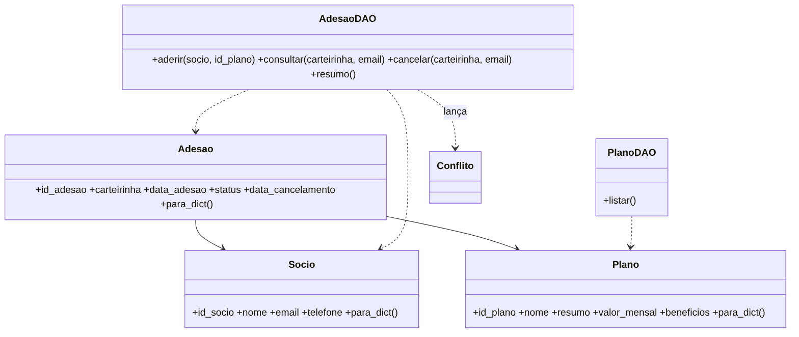

# Modelagem do Sócio Avanti

## Modelo do banco de dados

O banco possui três tabelas:

- **plano:** guarda os planos disponíveis.
- **socio:** guarda os dados de cada pessoa cadastrada.
- **adesao:** registra qual plano foi escolhido por cada sócio.

Um sócio pode ter mais de uma adesão ao longo do tempo. Cada adesão fica ligada a um sócio e a um plano.

## Arquivo SQL

A criação das três tabelas e a inclusão dos planos iniciais estão juntas em [py/sql/schema.sql](../py/sql/schema.sql). Assim, o projeto precisa de apenas um arquivo SQL.

## Classes do Python

- **Socio:** guarda e valida os dados do cadastro.
- **Plano:** guarda as informações de cada plano.
- **Adesao:** representa o cadastro de um sócio em um plano.
- **PlanoDAO e AdesaoDAO:** fazem a comunicação entre o Python e o banco de dados.

## Rotas principais

| Método | Rota | Função |
| --- | --- | --- |
| GET | /api/planos | Lista os planos. |
| POST | /api/adesoes | Cadastra um sócio e cria a carteirinha. |
| POST | /api/adesoes/consulta | Consulta uma carteirinha. |
| DELETE | /api/adesoes/<carteirinha> | Cancela uma adesão. |

O JavaScript usa fetch para enviar e receber os dados do Flask.
